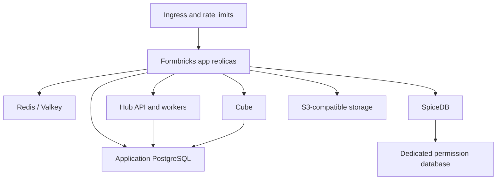

Running Formbricks as a cluster of multiple instances gives you:

- **High Availability**: surveys remain accessible even if one app pod becomes unavailable
- **Load Distribution**: traffic can be spread across multiple stateless Formbricks app instances
- **Scalability**: you can scale app replicas horizontally as usage grows
- **Zero-Downtime Updates**: rolling deployments are possible with the right orchestration setup

## Requirements

For a Formbricks v5 cluster setup, plan for:

- shared PostgreSQL for Formbricks and Hub, with `pgvector` support if Hub shares the same database
- shared Redis/Valkey for caching, rate limiting, and audit-related flows
- shared S3-compatible storage if you use file uploads or organization branding assets (or one
  `ReadWriteMany` volume mounted at `UPLOADS_DIR` on every app pod)
- a load balancer or ingress layer in front of the app
- Formbricks Hub as part of the runtime
- Cube, either bundled or externally managed
- Envoy Gateway or an equivalent external edge rate limiter for the v5-covered public and API-key routes

## Architecture

Hub can use a separate database. App workers use Redis; Hub workers use PostgreSQL.
SpiceDB is required for permission decisions and has no legacy authorization fallback.

## Availability

- Run multiple app replicas across nodes, with capacity for a failed node and a rolling restart.
- Configure disruption budgets, readiness and your managed datastores for the availability you need.
- Monitor dependency health and permission checks as well as `/health`.

Multiple replicas do not guarantee uninterrupted upgrades. Database, permission-schema and queue
changes may require maintenance. Follow the [Kubernetes upgrade procedure](/self-hosting/upgrade/kubernetes) in a maintenance window.

## Scaling

Watch CPU, memory, database connections and [queue depth](/self-hosting/configuration/job-runner)
separately. The default app HPA scales on CPU and memory, not backlog. Limit replicas to available
node and database capacity. Use the [sizing guidance](/self-hosting/overview) as a starting point,
then measure your workload.

All replicas need the same configuration, secrets and asset storage. Configure
[Redis](/self-hosting/configuration/environment-variables) and [file uploads](/self-hosting/configuration/file-uploads)
once for the deployment, not separately per replica.
