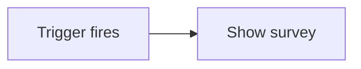
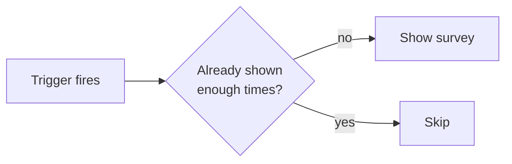
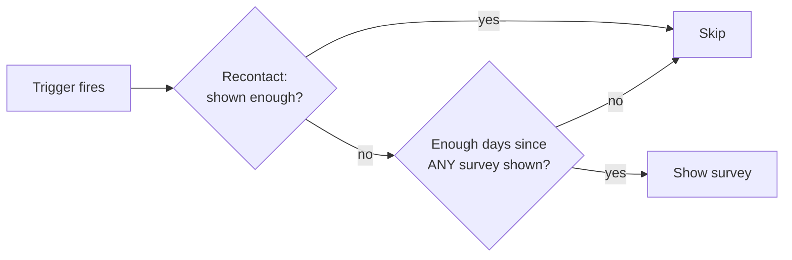
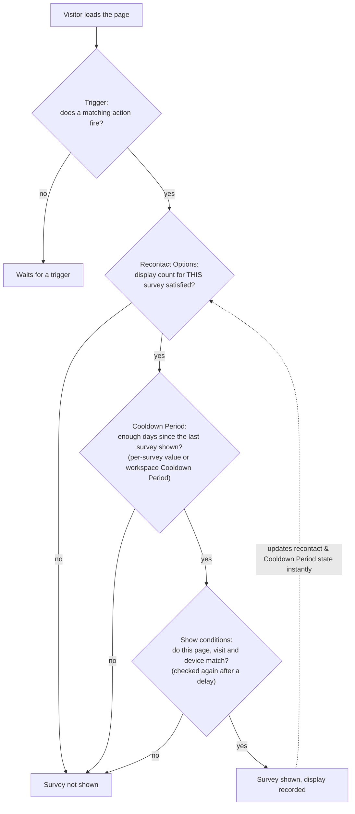

Whether an app survey is shown to a given user comes down to a matching **trigger** plus a few independent **eligibility gates**. When a trigger fires, the survey appears only if it passes **all** of the gates. This page builds that model up one layer at a time, from the simplest case to the most advanced.

Formbricks decides a survey's eligibility from two gates, evaluated in this order:

1. **Recontact Options**: how often may *this* survey be shown to the same user?
2. **Cooldown Period**: has enough time passed since the user last saw *any* survey?

A **Trigger** (a matching action) is the event that then shows an already-eligible survey. It is not a third gate, it is what starts a display attempt. The gates are computed up front (on load and whenever the user's data syncs); the trigger is checked against that result.

When the trigger fires, the survey's [show conditions](/surveys/website-app-surveys/show-conditions) are checked: the page, the visit so far and the device. Only a survey that meets them goes on to the [display percentage](/surveys/website-app-surveys/show-survey-to-percent-of-users), so the percentage samples visitors who qualify. They are covered in Level 3.

## Level 0: Always show

Take a survey with **no Cooldown Period** and Recontact set to **"Keep showing while conditions match"**. Nothing gates it, so it shows **every time its trigger fires**. Simple, but usually too aggressive for anything but a persistent feedback button.

## Level 1: Recontact Options (per survey)

Recontact Options control how often a single survey may reappear. They count *this* survey's own displays and responses, so they are genuinely **per survey**:

| Option | Shows the survey… |
| --- | --- |
| **Show only once** (default) | once, ever |
| **Show a limited number of times** | up to N displays, or until the user responds |
| **Ask until they submit a response** | on each trigger until the user responds |
| **Keep showing while conditions match** | on every trigger (Level 0) |

**Example:** an onboarding survey set to *Ask until they submit a response* keeps appearing on each trigger until the user answers, then stops.

See [Recontact Options](/surveys/website-app-surveys/recontact) for setup.

## Level 2: Cooldown Period between surveys

On top of per-survey recontact, a **Cooldown Period** enforces a minimum gap between surveys. Two settings feed it, but they share **one clock**:

- **Workspace Cooldown Period** (default **7 days**): after a user sees *any* survey, no survey shows again for the Cooldown Period.
- **Per-survey override** (*Ignore Cooldown Period* / *Set custom Cooldown Period*): replaces the workspace number **for that survey only**.

<Warning>
  The Cooldown Period is measured from the last time the user saw **any** survey, not from the last time they saw *this* one. So a per-survey "wait 90 days" really means "90 days since the user saw *any* survey," which frequently-shown surveys keep resetting. The per-survey number changes the *value*, not the *clock*.
</Warning>

**Example:** with the default 7-day Cooldown Period, showing any short survey today blocks *every* survey, including a quarterly NPS, for the next 7 days.

See [Cooldown Period](/surveys/website-app-surveys/cooldown-period) for setup.

## Level 3: Show conditions (page, visit, device)

[Show conditions](/surveys/website-app-surveys/show-conditions) are checked at the moment a trigger fires, on the visitor's own page: is this the right page, has the visit gone on long enough, is it the right device? They need no login, so they work for anonymous visitors, and they are available on every plan.

**Example:** an exit survey on the plan pages only, for visitors who have spent two minutes on the site or seen three pages. The trigger is exit intent; the conditions are *Current URL contains any of /plan-compare* and *Time on site is at least 120 seconds or Pages viewed is at least 3*.

They are checked again right before the survey appears, after its delay if it has one.

## Putting it all together

---

Still have questions or seeing unexpected behavior? [Join us in GitHub Discussions](https://github.com/formbricks/formbricks/discussions) and we'll be glad to help.
